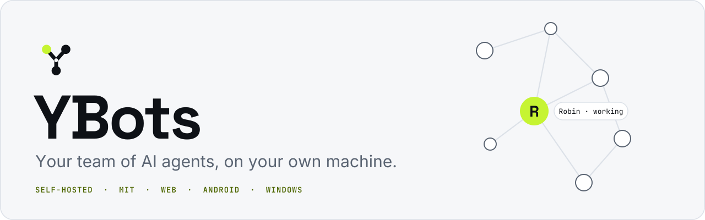
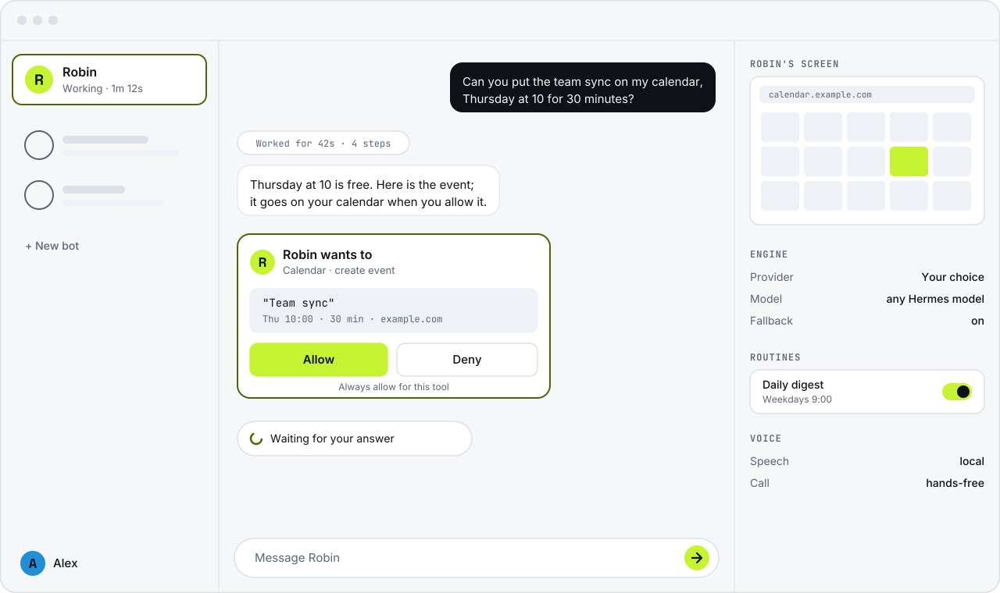
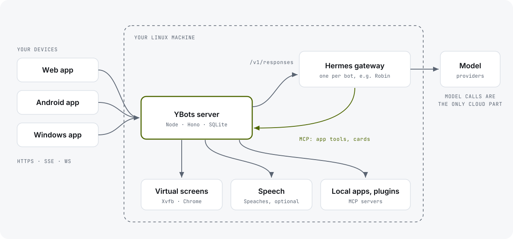
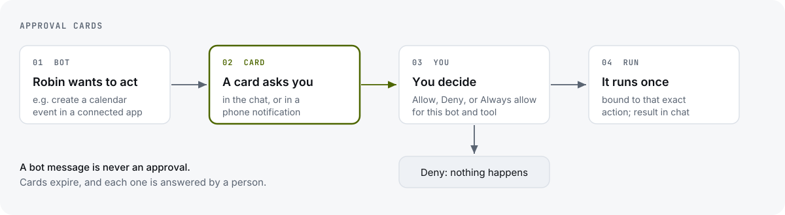

<p align="center">
  <picture>
    <source media="(prefers-color-scheme: dark)" srcset="assets/readme/banner-dark.svg">
    
  </picture>
</p>

<p align="center">
  A self-hosted team of AI agents you chat with. Each bot has its own name, memory, model and screen,<br>
  all on one Linux machine of yours, with web, Android and Windows apps.
</p>

<p align="center">
  <a href="INSTALL.md">Install</a> ·
  <a href="llms-install.md">Install with an AI agent</a> ·
  <a href="#what-you-get">Features</a> ·
  <a href="#how-it-fits-together">How it works</a> ·
  <a href="SECURITY.md">Security</a> ·
  <a href="#documentation">Docs</a> ·
  <a href="CONTRIBUTING.md">Contributing</a>
</p>

<p align="center">
  
  
  
  
</p>

<p align="center">
  <picture>
    <source media="(prefers-color-scheme: dark)" srcset="assets/readme/app-dark.svg">
    
  </picture>
</p>

<sub>An illustration with sample data, not a real install.</sub>

<p align="center"></p>

Give a bot a job, connect the apps it needs, and follow its work in chat. Every bot is a
[Hermes Agent](https://github.com/NousResearch/hermes-agent), so it runs on the model subscriptions or API
keys you already have (ChatGPT/Codex, Claude, OpenRouter, Nous Portal, local models and others). Everything
else runs on your machine: the bots' screens and browsers, the apps they use, speech, and the app itself.
The only thing that leaves it is what a bot sends to its model and to the services you connect.

YBots started as a fork of [Bot HQ](https://github.com/nickvasilescu/bot-hq) by Nick Vasilescu (MIT),
rebuilt to run entirely on your own machine. See [NOTICE.md](NOTICE.md).

## What you get

| | |
|---|---|
| **Chat that shows the work** | What a bot is doing right now, for how long, and each step it took. Finished turns fold into a "Worked for 2m 10s · 7 steps" chip. Stop a turn at any time. |
| **A screen per bot** | Each bot has its own virtual desktop with Chrome on the machine. Watch it live, open it full size, or take over with your own mouse and keyboard. |
| **Approval cards** | Every action in a connected app waits for your OK on a card in the chat (or in a phone notification) until you choose **Always allow** for it. Emails are sent only from a full-email card you press Send on. |
| **A model per bot** | Pick each bot's provider and model, with fallbacks, from its Engine panel. |
| **Bots that work together** | Bots message each other and share group chats; a bot can have helpers for side jobs. A bot message is never an approval. |
| **Connected apps, plugins, connectors** | Local MCP servers from `apps.json`, plugins that run in a container, remote MCP connectors and Google sign-in, all behind the same cards. |
| **Voice** | Call a bot hands-free, interrupt it, hear progress and answer cards by voice. Live dictation in every app. Speech runs locally (Whisper and Kokoro through Speaches). |
| **Routines, tasks, files and pages** | Scheduled jobs, a task list per bot, a file pane with previews, and Pages: documents and live calculators a bot makes and keeps up to date. |
| **Your PCs, if you want** | Pair a Windows PC and a bot can work on it, only in folders you share, each action on a card. |
| **Three apps** | The web app (installable), an Android app and a Windows app, with the same features. |
| **A household view** | Optional: give a family member a sign-in that sees only their own bot, with a simple hub for groceries, reminders and ideas. |

## How it fits together

<p align="center">
  <picture>
    <source media="(prefers-color-scheme: dark)" srcset="assets/readme/architecture-dark.svg">
    
  </picture>
</p>

- **The first bot is the owner's own Hermes agent** (its memory, skills and messaging channels keep
  working). Every other bot gets its own Hermes home, gateway, model, memory, browser profile and files.
- **The app's tools reach the bots over MCP** on loopback only: approval cards, files, routines, tasks,
  messages to other bots, connected apps.
- **Sign-in** is by one-time QR code or link from a signed-in device, by Cloudflare Access, or by a link
  made on the server for the first sign-in. There are no passwords.

More: [docs/ARCHITECTURE.md](docs/ARCHITECTURE.md).

## Install

On a fresh Ubuntu 24.04 or Debian 12 machine, as root:

```bash
git clone https://github.com/myanceyiii/ybots.git /opt/ybots && cd /opt/ybots
ALLOWED_EMAILS=you@example.com SETUP_HERMES=1 bash scripts/setup-local.sh
HERMES_HOME=~/.hermes hermes model                  # sign the first bot in to a model
bash scripts/sign-in-link.sh you@example.com        # one-time sign-in link and QR code
```

[INSTALL.md](INSTALL.md) has every step: requirements, HTTPS with Tailscale, Cloudflare or your own proxy,
voice, apps, backups, upgrades, uninstall and troubleshooting. To have a coding agent do it, point it at
[llms-install.md](llms-install.md).

Phones and PCs: [Android](docs/android.md) · [Windows](docs/windows-app.md) · any browser.

## Security in one paragraph

Bots are AI agents with a shell, a browser and your connected apps on one machine, running as root. Anyone
who can sign in, or get text in front of a bot (an email, a web page), may be able to steer it. YBots puts
your OK in front of every app action (approval cards bound to the exact action, expiring, recorded), never
treats a bot's message as an approval, keeps its agent endpoints on loopback, and signs people in without
passwords. Run it on a machine of its own, keep it behind HTTPS and a sign-in, and read
[SECURITY.md](SECURITY.md) first.

<p align="center">
  <picture>
    <source media="(prefers-color-scheme: dark)" srcset="assets/readme/approvals-dark.svg">
    
  </picture>
</p>

## Documentation

| | |
|---|---|
| Setting up | [INSTALL.md](INSTALL.md), [llms-install.md](llms-install.md), [.env.example](.env.example) (every setting) |
| Apps | [Android](docs/android.md), [Windows](docs/windows-app.md), [voice and calls](docs/voice.md), [phone actions](docs/phone-actions.md) |
| Connecting things | [local apps](docs/local-apps.md), [plugins](docs/plugins.md), [connectors](docs/connector-admin.md), [model providers](docs/provider-catalog.md), [model choice](docs/model-selection.md) |
| Features | [pages](docs/pages.md), [answer views](docs/answer-views.md), [helpers](docs/helpers.md), [browser cards](docs/browser-cards.md), [your PCs](docs/remote-pc.md) |
| Walled bots (optional) | [a bot reached over Slack](docs/sheldon-link.md), [a bot in a sealed container](docs/sheldon-silo.md) |
| Running it | [operations](docs/operations.md), [architecture](docs/ARCHITECTURE.md), [security](SECURITY.md) |
| Working on it | [CONTRIBUTING.md](CONTRIBUTING.md), [AGENTS.md](AGENTS.md) |

The example bots in the docs (Leonard for the household and money, Howard for running the server,
Sheldon walled off for work) are one family's setup. Name and shape your own.

## Signing in

Nobody has to run a command on the server to sign in day to day:

- **Sign in another device.** On any signed-in device, open the account menu and choose **Sign in another
  device**. It shows a QR code and a link that sign in the same account once, within 15 minutes, for the
  phone app or another browser. The Windows app can also show its own QR code for a signed-in phone to
  approve.
- **Behind Cloudflare Access.** Set `CF_ACCESS_TEAM_DOMAIN` (your team, e.g. `myteam`) and `CF_ACCESS_AUD`
  (the Access application's Audience tag). Opening the app through Access then signs you in as the address
  Access let through, if it is on `ALLOWED_EMAILS`. The app checks the signature of the
  `Cf-Access-Jwt-Assertion` token against your team's published keys, plus issuer, audience and expiry.
  Service tokens name no person and sign nobody in. `CF_ACCESS_ACCOUNTS=you@gmail.com=owner@example.com`
  maps an Access address to an account made under another one; `DISPLAY_NAMES=you@example.com=You` shows a
  name instead of an address. Phones can reach an Access-protected address without a VPN with one Access
  service token each: list them as `CF_ACCESS_PHONE_TOKENS=you@example.com=/etc/cleftbot/phone-access/you.env`
  (root-only files with `CFA_ID=` and `CFA_SECRET=`); codes that person makes then carry it.
- **The first sign-in:** `bash scripts/sign-in-link.sh you@example.com` on the machine.

## Status and limits

- Experimental. Expect changes; read the release notes before upgrading.
- Bots share one machine and run as root. What an extra bot does in its own shell, files or browser is
  gated by Hermes' approval prompts shown as cards (`HERMES_GATE=1`, the default), not by a sandbox.
- Bots per install: `MAX_BOTS` (default 4); each browsing bot needs about 1.5 GB of memory.
- Older names: the project was called YanceyBot, Cleft Bot, Bot HQ and Grokbot. Settings, service names
  and folders from those names (`CLEFTBOT_*`, `cleft-bot`, `/root/bothq`) keep working.

## License and credits

[MIT](LICENSE). Upstream: [Bot HQ](https://github.com/nickvasilescu/bot-hq) by Nick Vasilescu, MIT, which
grew out of [Orgo Teammates](https://github.com/nickvasilescu/orgo-teammates). Built with
[Hermes Agent](https://github.com/NousResearch/hermes-agent) (MIT), [Speaches](https://speaches.ai),
[noVNC](https://novnc.com), [Expo](https://expo.dev) and [Electron](https://www.electronjs.org). Bot
characters, icons and README art were made for the project (icons from [Lucide](https://lucide.dev)); app
logos on cards belong to their owners. See [NOTICE.md](NOTICE.md) and
[THIRD_PARTY_NOTICES.md](THIRD_PARTY_NOTICES.md).

## Disclaimer

- **Independent and unofficial.** YBots is not affiliated with, endorsed by or sponsored by Nous Research,
  OpenAI, Anthropic, Google, xAI, Cloudflare, Tailscale, Orgo, Composio or any other company or product named
  here. Their names are trademarks of their owners and are used only to describe compatibility.
- **Provided as is**, without warranty of any kind, under the MIT license. Expect bugs and breaking changes.
- **You are responsible for how you use it**: your keys and what they cost, the terms of every provider you
  connect, applicable law, and supervising agents that act on real accounts. Bots can send messages, spend
  money and change data on your behalf.
